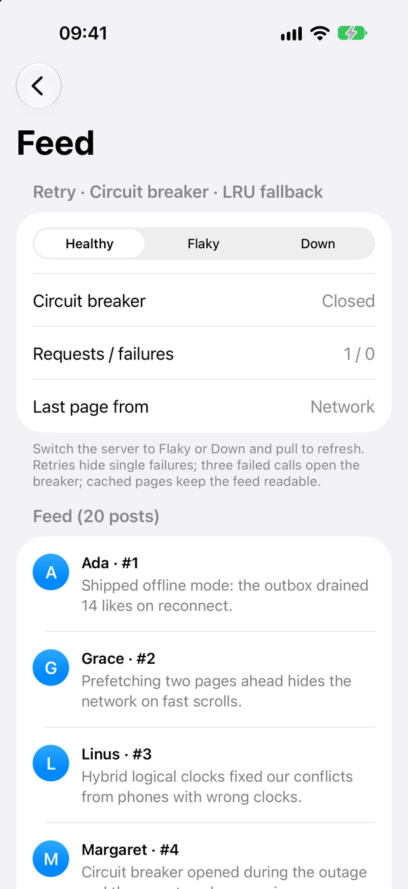
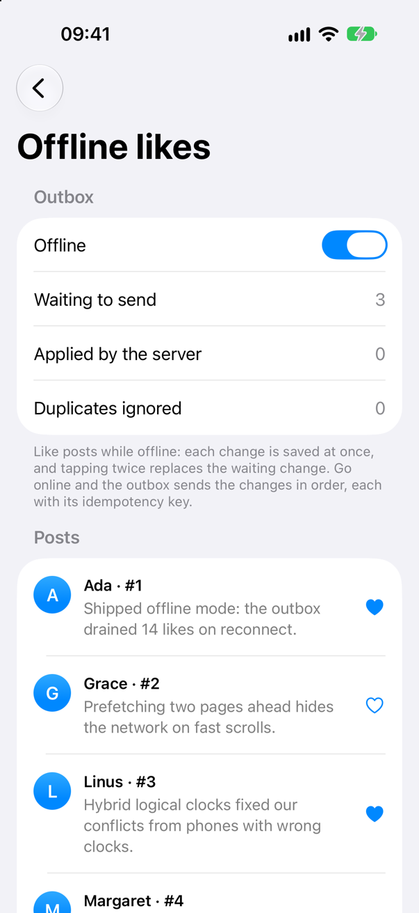
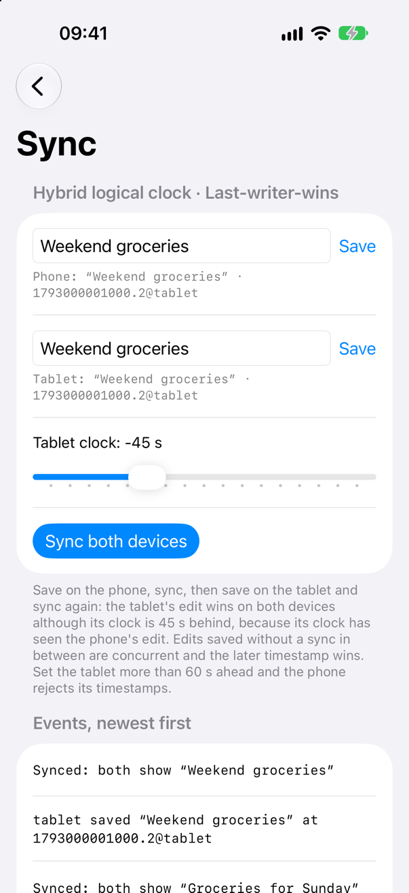
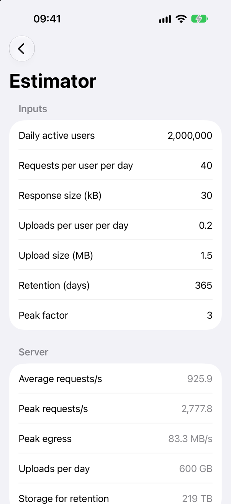

<!-- i18n-source: README.md@cb1bed719d3d683e6e86c775015a12ee159071a5 status=reviewed -->
<!-- brand:start -->

<p align="center"><picture><source media="(prefers-color-scheme: dark)" srcset="https://raw.githubusercontent.com/muhittincamdali/mobile-system-design/main/.github/brand/banner-dark.svg"><source media="(prefers-color-scheme: light)" srcset="https://raw.githubusercontent.com/muhittincamdali/mobile-system-design/main/.github/brand/banner-light.svg"></picture></p>

<!-- lang-selector:start -->
<p align="center"><a href="README.md">English</a> · <a href="README.tr.md">Türkçe</a> · <a href="README.zh-CN.md">简体中文</a> · <a href="README.ja.md">日本語</a> · <a href="README.ko.md">한국어</a> · <a href="README.es.md">Español</a> · <a href="README.de.md">Deutsch</a> · <a href="README.fr.md">Français</a> · <a href="README.pt-BR.md">Português (Brasil)</a> · <a href="README.ru.md">Русский</a></p>
<!-- lang-selector:end -->

<p align="center">
<a href="https://github.com/muhittincamdali/mobile-system-design/actions/workflows/ci.yml"></a>
<a href="https://github.com/muhittincamdali/mobile-system-design/releases"><picture><source media="(prefers-color-scheme: dark)" srcset="https://raw.githubusercontent.com/muhittincamdali/mobile-system-design/main/.github/brand/badge-version-dark.svg"><source media="(prefers-color-scheme: light)" srcset="https://raw.githubusercontent.com/muhittincamdali/mobile-system-design/main/.github/brand/badge-version-light.svg"></picture></a>
<a href="https://github.com/muhittincamdali/mobile-system-design/blob/main/Package.swift"><picture><source media="(prefers-color-scheme: dark)" srcset="https://raw.githubusercontent.com/muhittincamdali/mobile-system-design/main/.github/brand/badge-platforms-dark.svg"><source media="(prefers-color-scheme: light)" srcset="https://raw.githubusercontent.com/muhittincamdali/mobile-system-design/main/.github/brand/badge-platforms-light.svg"></picture></a>
<a href="https://github.com/muhittincamdali/mobile-system-design/blob/main/Package.swift"><picture><source media="(prefers-color-scheme: dark)" srcset="https://raw.githubusercontent.com/muhittincamdali/mobile-system-design/main/.github/brand/badge-language-dark.svg"><source media="(prefers-color-scheme: light)" srcset="https://raw.githubusercontent.com/muhittincamdali/mobile-system-design/main/.github/brand/badge-language-light.svg"></picture></a>
<a href="https://github.com/muhittincamdali/mobile-system-design/blob/main/LICENSE"><picture><source media="(prefers-color-scheme: dark)" srcset="https://raw.githubusercontent.com/muhittincamdali/mobile-system-design/main/.github/brand/badge-license-dark.svg"><source media="(prefers-color-scheme: light)" srcset="https://raw.githubusercontent.com/muhittincamdali/mobile-system-design/main/.github/brand/badge-license-light.svg"></picture></a>
</p>

<p align="center">
<a href="#inicio-rápido"><picture><source media="(prefers-color-scheme: dark)" srcset="https://raw.githubusercontent.com/muhittincamdali/mobile-system-design/main/.github/brand/button-start-es-dark.svg"><source media="(prefers-color-scheme: light)" srcset="https://raw.githubusercontent.com/muhittincamdali/mobile-system-design/main/.github/brand/button-start-es-light.svg"></picture></a>
<a href="https://muhittincamdali.github.io/mobile-system-design/documentation/mobilesystemdesign/"><picture><source media="(prefers-color-scheme: dark)" srcset="https://raw.githubusercontent.com/muhittincamdali/mobile-system-design/main/.github/brand/button-docs-es-dark.svg"><source media="(prefers-color-scheme: light)" srcset="https://raw.githubusercontent.com/muhittincamdali/mobile-system-design/main/.github/brand/button-docs-es-light.svg"></picture></a>
<a href="https://github.com/muhittincamdali/mobile-system-design/tree/main/Examples"><picture><source media="(prefers-color-scheme: dark)" srcset="https://raw.githubusercontent.com/muhittincamdali/mobile-system-design/main/.github/brand/button-examples-es-dark.svg"><source media="(prefers-color-scheme: light)" srcset="https://raw.githubusercontent.com/muhittincamdali/mobile-system-design/main/.github/brand/button-examples-es-light.svg"></picture></a>
</p>

> Esta es una traducción del README en inglés. Si hay diferencias, la versión en inglés es la vigente.

<!-- brand:end -->

Una guía para diseñar el lado cliente de las apps móviles (feeds, chat, seguimiento en vivo, medios sin conexión) junto con un paquete de Swift que implementa sus componentes básicos. Está pensada para ingenieros que se preparan para entrevistas de mobile system design y para equipos que escriben documentos de diseño. La guía explica cada pregunta de diseño; el paquete da la respuesta en forma de tipos de Swift pequeños, sin dependencias y con pruebas, de modo que puedes leer el código que hay detrás de cada recomendación, ejecutarlo en la app de ejemplo y usarlo en la tuya.

## Lo más destacado

- **Un marco de trabajo y cuatro casos prácticos**: una estructura de seis pasos para una sesión de 45 a 60 minutos, aplicada a un feed de fotos, una app de chat, el seguimiento en vivo de un viaje y las descargas de música sin conexión.
- **Componentes básicos que puedes ejecutar**: LRU cache, reintentos con backoff y `Retry-After`, circuit breaker, token bucket, paginator basado en cursor, outbox persistente, hybrid logical clock y last-writer-wins register, y estimaciones de capacidad.
- **Pensado para entradas incorrectas**: los valores que vienen de la configuración remota, de las cabeceras del servidor y de archivos guardados se limitan o se rechazan. No hay cierres inesperados por NaN, desbordamiento o una cabecera mal formada, ni bucles infinitos con un servidor que repite su cursor, y toda cola y toda caché tiene un límite de tamaño.
- **Modo de lenguaje Swift 6**: actors para el estado compartido, tipos `Sendable` y cero advertencias.
- **Con pruebas**: 111 pruebas de Swift Testing, ejecutadas en macOS y en un simulador de iPhone, que incluyen los ejemplos del README de más abajo.
- **Una app de ejemplo**: [SystemDesignLab](Examples/SystemDesignLab) ejecuta cada componente básico contra un servidor simulado al que puedes hacer inestable, tumbar o desconectar.

### Qué incluye

| Área                 | Tipos            | Página de la guía                                                                              |
| -------------------- | ---------------- | ---------------------------------------------------------------------------------------------- |
| Caché                | `LRUCache`    | [Caché y carga de imágenes](docs/topics/caching-and-images.md)                                 |
| Resiliencia          | `RetryPolicy`, `Retrier`, `RetryDecision`, `RetryAfter`, `HTTPStatusError`, `CircuitBreaker`, `TokenBucket` | [Resiliencia de red y actualizaciones en tiempo real](docs/topics/resilience-and-real-time.md) |
| Paginación           | `Paginator`, `Page` | [Diseño de API y paginación](docs/topics/api-and-pagination.md)                                |
| Cambios sin conexión | `Outbox`, `FileOutboxStore`, `InMemoryOutboxStore`    | [Soporte sin conexión y sincronización](docs/topics/offline-and-sync.md)                       |
| Sincronización       | `HybridLogicalClock`, `HybridTimestamp`, `LWWRegister`       | [Soporte sin conexión y sincronización](docs/topics/offline-and-sync.md#conflicts)             |
| Estimación           | `CapacityEstimate`, `ClientBudget` | [Un marco para el mobile system design](docs/framework.md#2-estimate)                          |

## Inicio rápido

**1. Añade el paquete**

En Xcode, elige **File › Add Package Dependencies…** e introduce la URL del repositorio:

```text
https://github.com/muhittincamdali/mobile-system-design.git
```

Pégala en el campo de búsqueda de la esquina superior derecha de la ventana. Deja **Dependency Rule** en **Up to Next Major Version** desde `2.0.0` y haz clic en **Add Package**. En la ventana siguiente, elige el target de tu app junto a **MobileSystemDesign** y haz clic de nuevo en **Add Package**.

**2. Importa el módulo**

```swift
import MobileSystemDesign
```

Pon esta línea al principio del archivo de Swift donde uses el paquete.

**3. Úsalo**

En una app nueva de Xcode (**File › New › Project… › App**), sustituye todo el contenido de `ContentView.swift` por:

<!-- sample: quick-start -->

```swift
import MobileSystemDesign
import SwiftUI

struct FeedItem: Identifiable, Sendable {
    let id: Int
}

/// Stands in for your API: 100 items, 20 per page.
func loadPage(after cursor: Int?) async throws -> Page<FeedItem, Int> {
    let start = cursor ?? 0
    let end = min(start + 20, 100)
    let items = (start..<end).map { FeedItem(id: $0) }
    return Page(items: items, nextCursor: end < 100 ? end : nil)
}

struct ContentView: View {
    @State private var items: [FeedItem] = []
    private let feed = Paginator<FeedItem, Int> { cursor in
        try await loadPage(after: cursor)
    }

    var body: some View {
        List(items) { item in
            Text("Item \(item.id)")
                .task {
                    if item.id == items.last?.id { await loadMore() }
                }
        }
        .task { await loadMore() }
    }

    private func loadMore() async {
        if let page = try? await feed.loadNextPage() {
            items += page
        }
    }
}
```

Pulsa **Run** (⌘R). La app muestra una lista que carga 20 filas más cada vez que llegas al final y se detiene tras la fila 99. Sustituye `loadPage(after:)` por la llamada a tu API.

## Instalación

### Swift Package Manager

En Xcode, elige **File › Add Package Dependencies…** e introduce la URL del repositorio:

```text
https://github.com/muhittincamdali/mobile-system-design.git
```

O añádelo a las `dependencies` de tu `Package.swift`:

```swift
dependencies: [
    .package(url: "https://github.com/muhittincamdali/mobile-system-design.git", from: "2.0.0")
],
targets: [
    .target(name: "YourApp", dependencies: [
        .product(name: "MobileSystemDesign", package: "mobile-system-design")
    ])
]
```

## Uso

Los ejemplos de abajo están copiados de [`Examples/SystemDesignLab/SystemDesignLab/ReadmeSamples.swift`](Examples/SystemDesignLab/SystemDesignLab/ReadmeSamples.swift). La app de ejemplo compila ese archivo, la batería de pruebas lo compila y lo ejecuta, y `node scripts/check-readme-samples.mjs` comprueba que este README muestra el mismo código.

### Reintenta una petición y deja de llamar a un servidor que falla

Los fallos temporales (tiempos de espera agotados, conexiones perdidas, `429`, `503`) se reintentan con backoff exponencial y jitter; cinco fallos seguidos abren el circuit breaker y, durante 30 segundos, las llamadas fallan al instante en lugar de esperar a que venzan los tiempos de espera.

<!-- sample: resilient-request -->

```swift
static let retrier = Retrier(policy: RetryPolicy(maxAttempts: 3, initialDelay: .milliseconds(200)))
static let breaker = CircuitBreaker(configuration: .init(failureThreshold: 5, openDuration: .seconds(30)))

static func fetchProfile(from url: URL, session: URLSession = .shared) async throws -> Profile {
    try await retrier.run { _ in
        try await breaker.run {
            let (data, response) = try await session.data(from: url)
            if let http = response as? HTTPURLResponse, !(200..<300).contains(http.statusCode) {
                throw HTTPStatusError(response: http) // 429 and 5xx are retried
            }
            return try JSONDecoder().decode(Profile.self, from: data)
        }
    }
}
```

### Conserva los cambios hechos sin conexión hasta que se envíen

Cada cambio se guarda en un archivo antes de que `enqueue` devuelva el control, se envía empezando por el más antiguo cuando haces flush y lleva un UUID que puedes usar como clave de idempotencia de la petición.

<!-- sample: offline-outbox -->

```swift
struct LikeChange: Codable, Sendable {
    let postID: Int
    let liked: Bool
}

static func makeOutbox() throws -> Outbox<LikeChange> {
    let folder = try FileManager.default.url(
        for: .applicationSupportDirectory, in: .userDomainMask, appropriateFor: nil, create: true
    )
    let store = FileOutboxStore<LikeChange>(fileURL: folder.appendingPathComponent("outbox.json"))
    return try Outbox(store: store)
}

static func like(_ postID: Int, in outbox: Outbox<LikeChange>) async throws {
    // Saved before this returns; a second tap replaces the waiting change.
    try await outbox.enqueue(LikeChange(postID: postID, liked: true), coalescingKey: "like-\(postID)")
}

// Call when the network is back or the scene becomes active.
static func sendPending(
    from outbox: Outbox<LikeChange>,
    using send: @escaping @Sendable (LikeChange, UUID) async throws -> Void
) async -> OutboxFlushReport {
    await outbox.flush { entry in
        try await send(entry.payload, entry.id) // entry.id is the idempotency key
    }
}
```

### Almacena imágenes en la caché de memoria

<!-- sample: memory-cache -->

```swift
actor ThumbnailCache {
    // At most 200 images and 50 MB; entries expire after 10 minutes.
    private var cache = LRUCache<URL, Data>(countLimit: 200, costLimit: 50_000_000, timeToLive: 600)

    func image(for url: URL) -> Data? {
        cache.value(forKey: url)
    }

    func store(_ data: Data, for url: URL) {
        cache.insert(data, forKey: url, cost: data.count)
    }

    func didReceiveMemoryWarning() {
        cache.trim(toCost: cache.costLimit / 2)
    }
}
```

### Resuelve una edición hecha en dos dispositivos

Un hybrid logical clock ordena una edición después de todo lo que su dispositivo ha visto, de modo que la edición más reciente gana aunque el reloj de ese dispositivo vaya atrasado.

<!-- sample: sync -->

```swift
static func resolveConflict() throws -> String {
    var phone = HybridLogicalClock(node: "phone")
    var tablet = HybridLogicalClock(node: "tablet")
    let now = Date()

    var phoneTitle = LWWRegister("Groceries", timestamp: try phone.tick(physicalTime: now))
    // The tablet's clock is 30 seconds behind, but its edit happens later.
    _ = try tablet.receive(phoneTitle.timestamp, physicalTime: now.addingTimeInterval(-30))
    let tabletTitle = LWWRegister("Weekend groceries", timestamp: try tablet.tick(physicalTime: now.addingTimeInterval(-29)))

    // The phone's clock checks the tablet's timestamp before the copy can win.
    try phoneTitle.merge(tabletTitle, using: &phone, physicalTime: now.addingTimeInterval(1))
    return phoneTitle.value // "Weekend groceries"
}
```

### Estima la carga de una funcionalidad

<!-- sample: estimate -->

```swift
static func estimateFeed() throws -> CapacityEstimate {
    try CapacityEstimate(
        dailyActiveUsers: 2_000_000,
        requestsPerUserPerDay: 40,
        averageResponseBytes: 30_000,
        uploadsPerUserPerDay: 0.2,
        averageUploadBytes: 1_500_000,
        retentionDays: 365
    )
    // peakRequestsPerSecond ≈ 2,778 · dailyEgressBytes = 2.4 TB · storageBytes = 219 TB
}
```

## App de ejemplo

[SystemDesignLab](Examples/SystemDesignLab) tiene un laboratorio por cada componente básico. Su servidor se ejecuta dentro de la app, así que los laboratorios funcionan sin backend y se ven igual en cada ejecución.

| Feed                                                                                                                                           | Me gusta sin conexión                                                                                                                                     | Sincronización                                                                                                                                                            | Estimador                                                                                                                                |
| ---------------------------------------------------------------------------------------------------------------------------------------------- | --------------------------------------------------------------------------------------------------------------------------------------------------------- | ------------------------------------------------------------------------------------------------------------------------------------------------------------------------- | ---------------------------------------------------------------------------------------------------------------------------------------- |
| <picture><source media="(prefers-color-scheme: dark)" srcset="docs/images/lab-feed-dark.png"></picture> | <picture><source media="(prefers-color-scheme: dark)" srcset="docs/images/lab-outbox-dark.png"></picture> | <picture><source media="(prefers-color-scheme: dark)" srcset="docs/images/lab-sync-dark.png"></picture> | <picture><source media="(prefers-color-scheme: dark)" srcset="docs/images/lab-estimator-dark.png"></picture> |

Abre `Examples/SystemDesignLab/SystemDesignLab.xcodeproj`, elige un simulador de iPhone o **My Mac** y pulsa **Run**. Las capturas de pantalla las hace [`scripts/capture-screenshots.sh`](scripts/capture-screenshots.sh) a partir de la app en ejecución.

## Documentación

La [referencia de la API](https://muhittincamdali.github.io/mobile-system-design/documentation/mobilesystemdesign/) se genera con DocC a partir del código fuente y se publica con cada cambio en `main`.

## Guías

La guía de [`docs/`](docs) explica las preguntas de diseño:

- [Un marco para el mobile system design](docs/framework.md): los seis pasos, las preguntas que hay que hacer y las señales que buscan los evaluadores.
- Temas: [Diseño de API y paginación](docs/topics/api-and-pagination.md) ·
  [Caché y carga de imágenes](docs/topics/caching-and-images.md) ·
  [Soporte sin conexión y sincronización](docs/topics/offline-and-sync.md) ·
  [Resiliencia de red y actualizaciones en tiempo real](docs/topics/resilience-and-real-time.md)
- Casos prácticos: [un feed de fotos](docs/case-studies/news-feed.md) ·
  [una app de chat](docs/case-studies/chat-app.md) ·
  [seguimiento en vivo de un viaje](docs/case-studies/ride-tracking.md) ·
  [descargas de música sin conexión](docs/case-studies/offline-music.md)

Los artículos de DocC explican el código:
[Primeros pasos](Sources/MobileSystemDesign/MobileSystemDesign.docc/GettingStarted.md) ·
[Cómo construir una capa de red resiliente](Sources/MobileSystemDesign/MobileSystemDesign.docc/ResilientNetworking.md) ·
[Cómo diseñar un feed offline-first](Sources/MobileSystemDesign/MobileSystemDesign.docc/OfflineFirstFeeds.md) ·
[Cómo estimar la capacidad](Sources/MobileSystemDesign/MobileSystemDesign.docc/EstimatingCapacity.md)

## Requisitos

| Plataforma   | Versión mínima        |
| ------------ | --------------------- |
| iOS          | 17                    |
| macOS        | 14                    |
| Herramientas | Swift 6.2 · Xcode 26+ |

CI compila con el Xcode predeterminado de la imagen de runner `macos-26` de GitHub. El paquete se desarrolla con Xcode 27.

## Arquitectura

- `Sources/MobileSystemDesign/<Area>/` contiene una carpeta por área: `Caching`, `Resilience`, `Pagination`, `Offline`, `Sync` y `Estimation`. El paquete no tiene más dependencias que Foundation.
- El estado mutable compartido vive en actors (`CircuitBreaker`, `Paginator`, `Outbox`); las policies, las cachés y los relojes son tipos por valor que guardas dentro de tu propio actor.
- El tiempo siempre se inyecta (un reloj, un parámetro `now` o una función sleep), de modo que las pruebas lo controlan a mano y nunca esperan.
- Las entradas que pueden venir de fuera de la app (configuración remota, cabeceras HTTP, archivos guardados, marcas de tiempo de otros dispositivos) se limitan o se rechazan en el límite del tipo; las pruebas cubren NaN, infinito, `Int.max`, valores negativos y texto mal formado.
- CI ejecuta `swift test` en macOS y `xcodebuild test` en un simulador de iPhone, compila la app de ejemplo para iOS y macOS y publica la documentación de DocC.

Para ejecutar las pruebas en local:

```sh
swift test                                    # macOS
xcodebuild test -scheme MobileSystemDesign \
  -destination 'platform=iOS Simulator,name=iPhone 17'
```

## Hoja de ruta

- Más casos prácticos: un feed de vídeo con prefetching y un documento colaborativo.
- Un helper basado en `NWPathMonitor` que haga flush de un `Outbox` cuando vuelva la red.
- Añadir el paquete al Swift Package Index; `.spi.yml` ya está en el repositorio.

## Contribuir

Las contribuciones son bienvenidas. Lee la [guía de contribución](https://github.com/muhittincamdali/mobile-system-design/blob/main/CONTRIBUTING.md) y el [código de conducta](https://github.com/muhittincamdali/.github/blob/main/CODE_OF_CONDUCT.md) antes de abrir una pull request. Informa de los problemas de seguridad de forma privada, como se describe en la [política de seguridad](https://github.com/muhittincamdali/.github/blob/main/SECURITY.md).

## Licencia

Publicado bajo la licencia MIT. Consulta [LICENSE](LICENSE).
